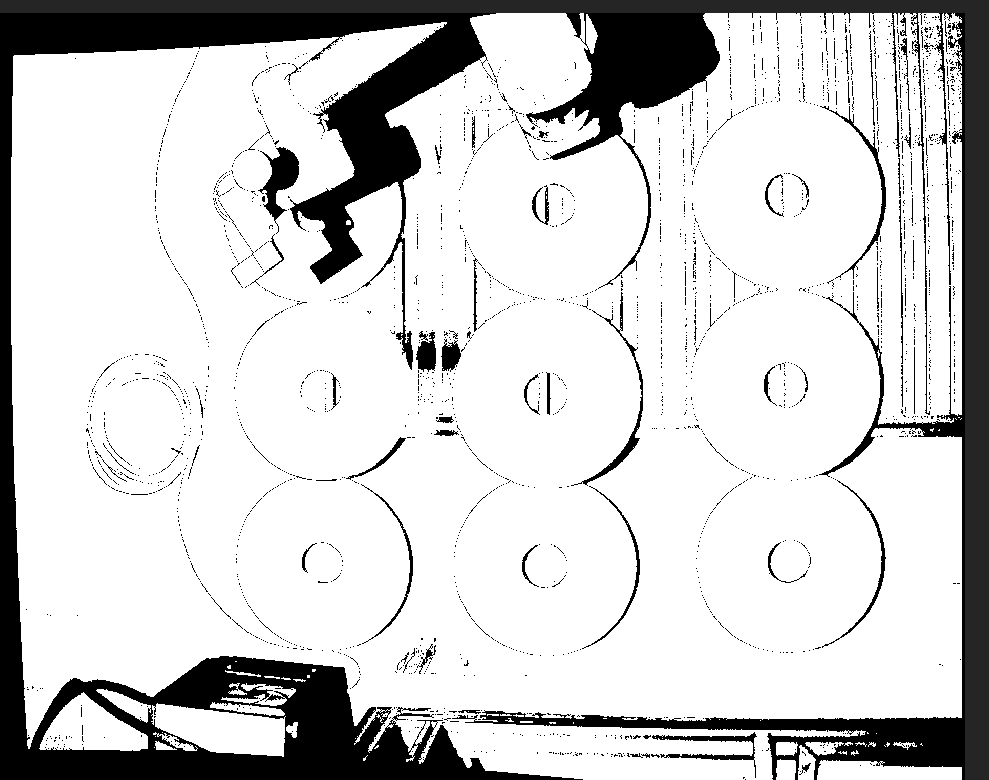
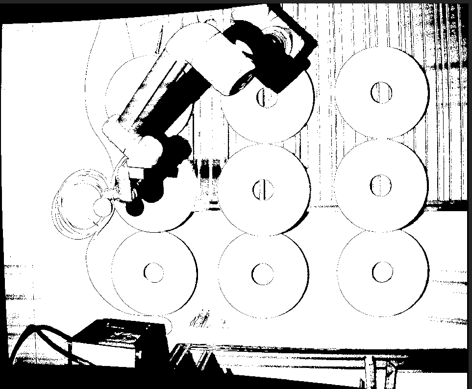
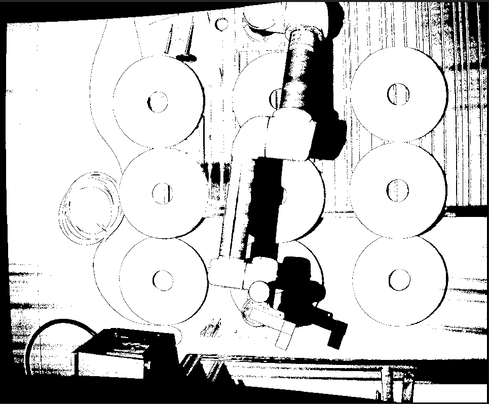
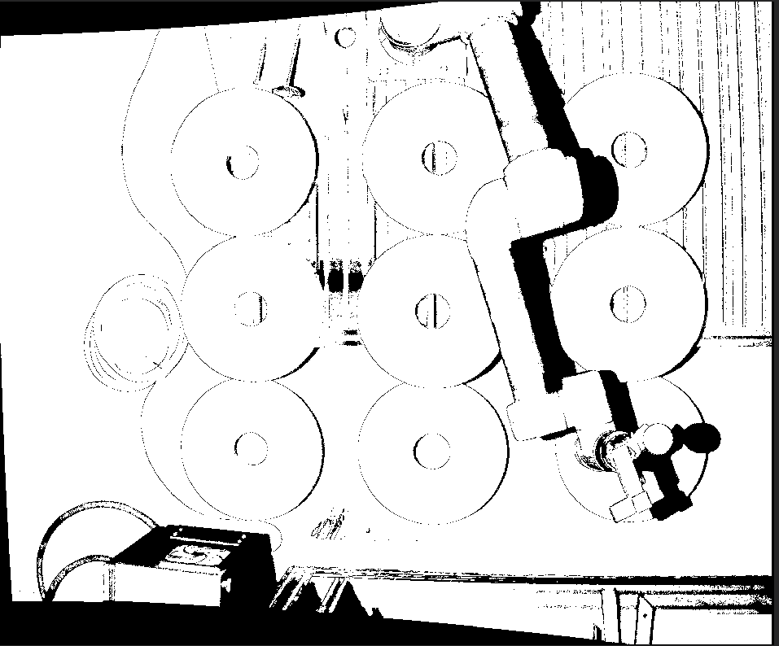
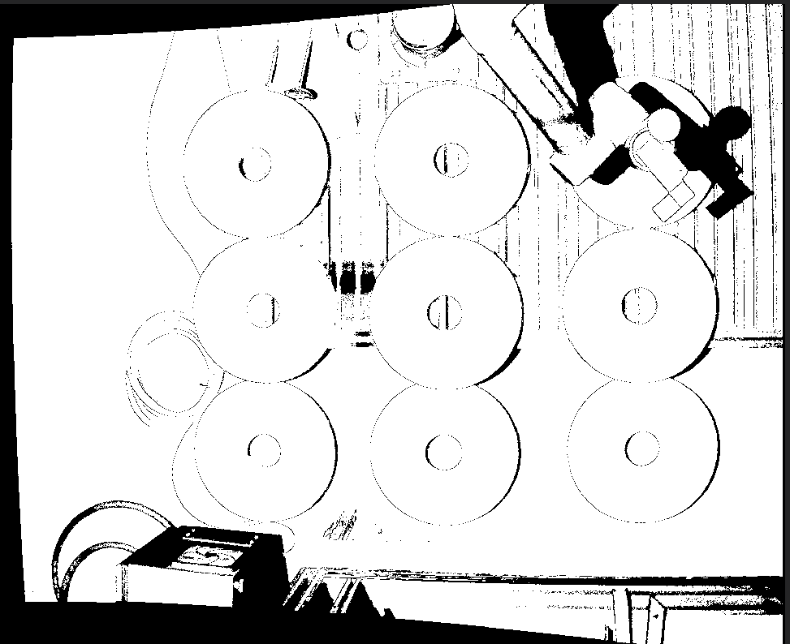
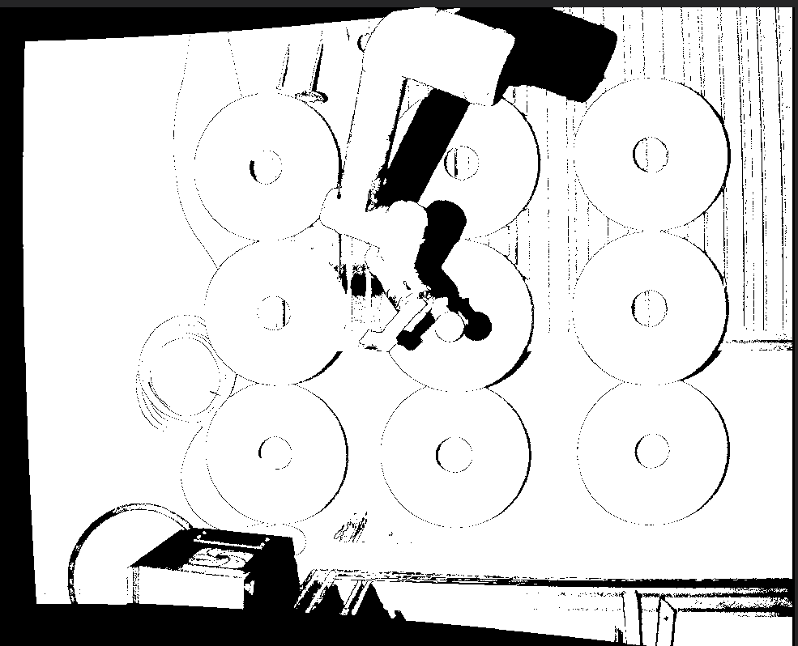

<div align="center">

# 🔧 eye-to-hand-calibration

**用 HALCON 做的一次手眼标定（eye-to-hand）**

<sub>Photoneo PhoXi 3D 扫描仪 + 机械臂 + 标定球</sub>
<sub>HALCON 21.05 · 2022 年夏天的实验记录</sub>

</div>

---

## 这是什么

一台**固定安装**的 3D 扫描仪（eye-to-hand），要看懂机械臂末端在它眼里的位置。
做法是让机器人带着标定球在视野里摆 20 个不同姿态，每个姿态记一组
「机器人末端位姿」+「点云里球的位姿」，扔给 HALCON 解出相机与机器人基座之间的变换。

> ( ¯꒳¯ ) 说白了就是：**让机器人和相机互相认识一下**。

<div align="center">



<sub>▲ 相机视野里：机械臂 + 标定球 + 标定板</sub>

</div>

---

## 目录

- [仓库里有什么](#仓库里有什么)
- [流程](#流程)
  - [1. 采集](#1-采集)
  - [2. 建模](#2-建模)
  - [3. 标定](#3-标定)
  - [4. 验证](#4-验证)
- [关键参数](#关键参数)
- [环境](#环境)
- [踩过的坑](#踩过的坑)

---

## 仓库里有什么

| 文件 / 目录 | 作用 |
| --- | --- |
| `get_calibration_data.hdev` | 连接 PhoXi、采点云、把点云转成标定板灰度图 |
| `perform_calibration.hdev` | 主标定脚本：建球模型、跑 20 组样本、解 hand-eye |
| `evaluation.hdev` | 标定完了验一遍：拟合平面 + 找内圆 + 算圆心误差 |
| `ball_test.hdev` | 球体版本的同款流程，换标定物用的 |
| `create_pose.hdev` | 手写一个位姿，纯粹拿来试数 |
| `Repose/Diff_Pose_*.dat` | 20 组标定位姿（旋转向量 + 平移，单位 m） |
| `Repose/Re_Cam2Obj_*.dat` | 20 组相机到物体的位姿 |
| `pointcloud/3d_CalBoarde_*.om3` | 20 个标定板点云（HALCON OM3 格式） |
| `BoardSurfaceModel.stl` | 标定板的三维模型，做 surface-based matching 用 |
| `pic/` | 过程截图，下面贴了一部分 |
| `PhotoneoLogFiles/` | PhoXi 的运行日志，排查连接问题用的 |

---

## 流程

### 1. 采集

`get_calibration_data.hdev` 负责和扫描仪说话。HALCON 通过 `PhoXi` 这个
frame grabber 接口连 Photoneo，设备靠序列号或索引挑：

```halcon
AcqName := 'PhoXi'
info_framegrabber (AcqName, 'device', DeviceInfo, DeviceValues)
open_framegrabber (AcqName, 1, 1, 0, 0, 0, 0, 'default', -1, 'default', -1, \
                   'false', 'default', DeviceValues[0], -1, -1, AcqHandle)
set_framegrabber_param (AcqHandle, 'use_grab_image_async_as_trigger_only', 'enable')
grab_image_async (TextureImage, AcqHandle, 0)
```

几个要点：

- **PhoXiControl 必须先跑起来**，否则 `open_framegrabber` 直接失败
- 输出结构要在 PhoXiControl 里勾好（`OutputStructure` → 选需要的字段 → `Set`），
  默认 `PointCloud` 和 `Texture` 都是 enabled
- 拿到的点云单位是 **mm**，后面要转成 **m** 再喂给标定
- `Texture` 图的对比度得手动调一下，不然标定板上的 DataMatrix 码读不出来

<div align="center">




<sub>▲ 机械臂带着球换姿势，每一帧对应一个标定样本</sub>

</div>

### 2. 建模

标定板要先有个 3D 模型，才能用 surface-based matching 在点云里找它。

```halcon
read_object_model_3d ('BoardSurfaceModel', 'm', [], [], BoardOM3D, Status)
create_surface_model (BoardOM3D, 0.02, [], [], BoardSurfaceModelID)
```

球的话更省事，直接生成一个解析球体（半径 **27.7 mm**）：

```halcon
gen_sphere_object_model_3d ([0,0,0,0,0,0,0], SphereRadius, SphereOM3D)
convex_hull_object_model_3d (SphereOM3D, SphereOM3D)
create_surface_model (SphereOM3D, 0.02, 'model_invert_normals', 'true', SphereSurfaceModelID)
```

那个 `0.02` 是相对采样距离，调小了匹配慢、调大了匹配飘。

<div align="center">




<sub>▲ 20 个姿态基本覆盖了整个工作空间</sub>

</div>

### 3. 标定

核心就两行：

```halcon
create_calib_data ('hand_eye_stationary_cam', 0, 0, HECCalibDataID)
set_calib_data (HECCalibDataID, 'model', 'general', 'optimization_method', 'nonlinear')
```

- `hand_eye_stationary_cam` = **相机固定不动**（eye-to-hand）。
  要是相机装在机械臂上，这里得换成 `hand_eye_moving_cam`
- `optimization_method` 选了 `nonlinear`，姿态精度最好，代价是慢一点

然后循环 20 个样本：

```halcon
NumCalibrationScenes := 20
for I := 1 to NumCalibrationScenes by 1
    read_object_model_3d (filename, 'm', [], [], ObjectModel3D, Status)
    object_model_3d_to_xyz (X, Y, Z, ObjectModel3D, 'from_xyz_map', [], [])
    get_object_model_3d_params (ObjectModel3D, '&intensity', intensity)
    set_grayval (Image, CalBoard_Rows, CalBoard_Columns, intensity)
    ...
endfor
```

这里有个小技巧：**把点云的强度值写进一张灰度图**，行列坐标用点云的 x/y 映射过去。
因为 `find_data_code_2d` 只吃 byte 类型图像，3D 点云不能直接喂，
绕一圈就能拿点云「拍」出一张标定板照片来读码。

> 🍮 有些样本匹配会失败，脚本里做了判断，**匹配不上的样本直接跳过不参与标定**，
> 硬塞进去反而会把结果拉歪。

<div align="center">



</div>

### 4. 验证

`evaluation.hdev` 是另一条路：不用标定球，直接对标定板做几何验证。

1. 手动画个 ROI，把平面部分裁出来
   ```halcon
   reduce_object_model_3d_by_view (PlaneROI, ObjectModel3D, CamParam, Pose, ObjectModel3D_Plane)
   fit_primitives_object_model_3d (ObjectModel3D_Plane, 'primitive_type', 'plane', OM3D_Plane)
   get_object_model_3d_params (OM3D_Plane, 'primitive_pose', Cam_H_Plane)
   ```
2. 用平面姿态把点云摆正，`pose_invert` 之后 `rigid_trans_object_model_3d`
3. 在摆正后的图上找内圆轮廓，`fit_circle_contour_xld` 拟合出圆心
4. 圆心实际坐标 vs 标定算出来的坐标，差值就是误差

```halcon
edges_sub_pix (ImageReduced, Circle0_Edges, 'canny', 2, 20, 60)
select_shape_xld (Circle0_Edges, Circle0_Edges_select, ['contlength','circularity'], 'and', [50,0.6], [500,1])
fit_circle_contour_xld (Circle0_Outer, 'ahuber', -1, 2, 0, 3, 2, \
                        Circle0_Row, Circle0_Column, Circle0_Radius, ...)
```

`'ahuber'` 是 Huber 加权，对轮廓上的离群点比较宽容——实测比默认的最小二乘稳。

---

## 关键参数

| 参数 | 值 | 说明 |
| --- | --- | --- |
| `NumCalibrationScenes` | 20 | 标定位姿数量 |
| `SphereRadius` | 27.7 | 标定球半径（mm） |
| 优化方法 | `nonlinear` | 姿态最准 |
| 标定类型 | `hand_eye_stationary_cam` | 相机固定 |
| 相机内参 | `gen_cam_par_area_scan_division` | 2064×1544，焦距 0.008 / 5.2e-06 像素尺寸 |

内参在几个脚本里不完全一致，是不同批次拍的：

```halcon
* 带畸变的版本
gen_cam_par_area_scan_division (0.0078066255, -0.121916, 0.00000345, 0.00000345, \
                                1071.03, 793.9, 2064, 1544, CamParam)
* 无畸变版本
gen_cam_par_area_scan_division (0.008, 0, 5.2e-06, 5.2e-06, \
                                1071.3, 793.9, 2064, 1544, CamParam)
```

位姿文件长这样（`Repose/Diff_Pose_01.dat`）：

```
# 3D POSE PARAMETERS: rotation and translation
f 0
r -0.198842898250703 4.0770661949706 7.42384111526009
t 1.49453245821141 1.25246473791518 -0.428090294941512
```

`r` 是旋转向量（Rodrigues，单位 deg），`t` 是平移（单位 **m**）。
HALCON 自己 `write_pose` 出来的格式，`read_pose` 能直接读。

---

## 环境

| 项 | 版本 / 型号 |
| --- | --- |
| HALCON | 21.05.0.0 Progress |
| 3D 扫描仪 | Photoneo PhoXi（HALCON 自带 `PhoXi` 接口） |
| 机械臂 | 任意能读出末端位姿的六轴 |
| 标定板 | 带 DataMatrix 码的平面板 + 27.7mm 标定球 |

脚本是 `.hdev` 的 XML 格式（HDevelop 保存的），直接用 HDevelop 打开就能跑。

---

## 踩过的坑

- **PhoXiControl 没开** → `open_framegrabber` 报错，先确认软件在跑、设备已连接
- **点云单位搞混** → HALCON 给的是 mm，标定要 m，差 1000 倍结果会离谱到看不出问题
- **`find_data_code_2d` 只吃 byte 图** → 必须先 `object_model_3d_to_xyz` + `set_grayval` 转一遍
- **样本质量不齐** → 匹配失败的样本一定要剔掉，宁可少几个也别污染数据
- **纹理图对比度** → 太低的话 DataMatrix 码读不出来，得手动调

---

<div align="center">

<sub>2022 年做的一点东西，留个档 (´-ω-`)</sub>

</div>
